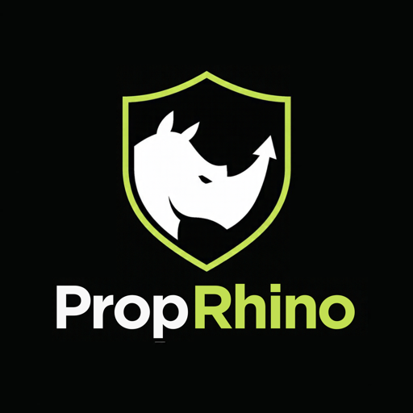

# PropRhino

Tracks prop firm trading as a business: accounts, expenses, payouts, imported
trades, and payout-rule compliance. See [project_brief.md](project_brief.md).

Stack: Vite + React + TypeScript, Tailwind + shadcn/ui, TanStack Query/Table,
Recharts, PapaParse, Supabase (Postgres + Auth + RLS).

## Setup

```sh
npm install
cp .env.example .env.local   # fill in your Supabase URL and anon key
npm run dev
```

Apply the schema by running the files in `supabase/migrations/` in order in the
Supabase SQL editor (or `supabase db push` with the Supabase CLI), then create a
user under Authentication → Users.

## AI review (optional)

The Performance page can ask Claude for written feedback on trading behaviour.
The calls run in Supabase Edge Functions so the Anthropic key stays off the
client. Run `supabase/migrations/0003_ai_reviews.sql` and
`0004_user_secrets.sql`, then deploy the functions once:

```sh
npx supabase login
npx supabase link --project-ref <your-project-ref>
npx supabase functions deploy
```

Each user then saves their own Anthropic API key on the Settings page.

## Scripts

- `npm run dev` – dev server
- `npm run build` – typecheck and production build
- `npm test` – unit tests (Vitest)
- `npm run lint` – oxlint

## Layout

- `supabase/migrations/` – schema and RLS policies; run each file in order
- `src/pages/` – one page per module: Dashboard, Accounts, Ledger, Trades, Performance, Compliance, Playbook
- `src/lib/pnl.ts` – Net Business P&L and per-firm summaries
- `src/lib/rules.ts` – consistency rule and minimum trading days, per payout cycle
- `src/lib/performance.ts`, `src/lib/breakdowns.ts`, `src/lib/tags.ts` – trading statistics
- `src/lib/csv/` – Tradovate and NinjaTrader CSV parsers (NinjaTrader is unverified against a real export)
- `src/lib/review.ts` – statistics sent for the AI review
- `supabase/functions/review/` – edge function that calls Claude and stores the review
- `supabase/functions/api-key/` – edge function that stores each user's Anthropic key
- `src/lib/queries.ts` – Supabase data hooks
- `src/components/ui/` – shadcn/ui components (add more with `npx shadcn@latest add <name>`)
